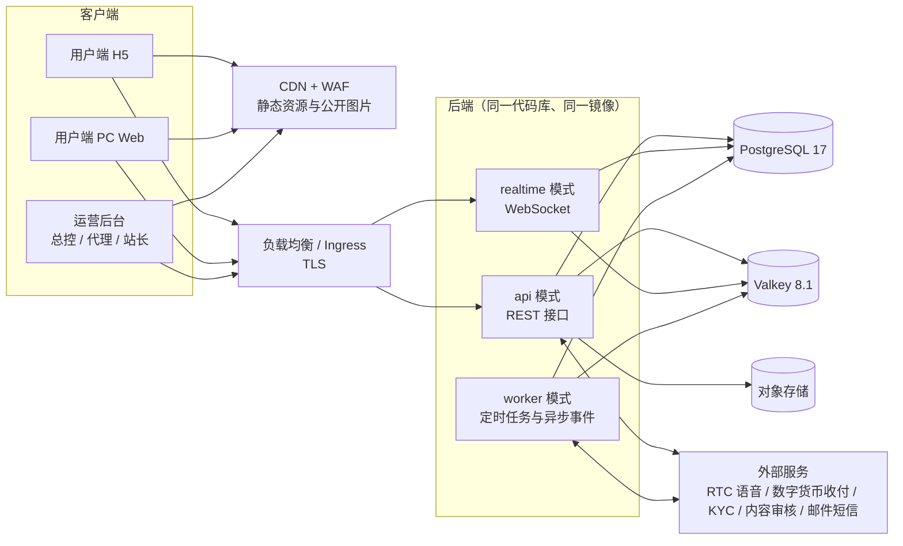
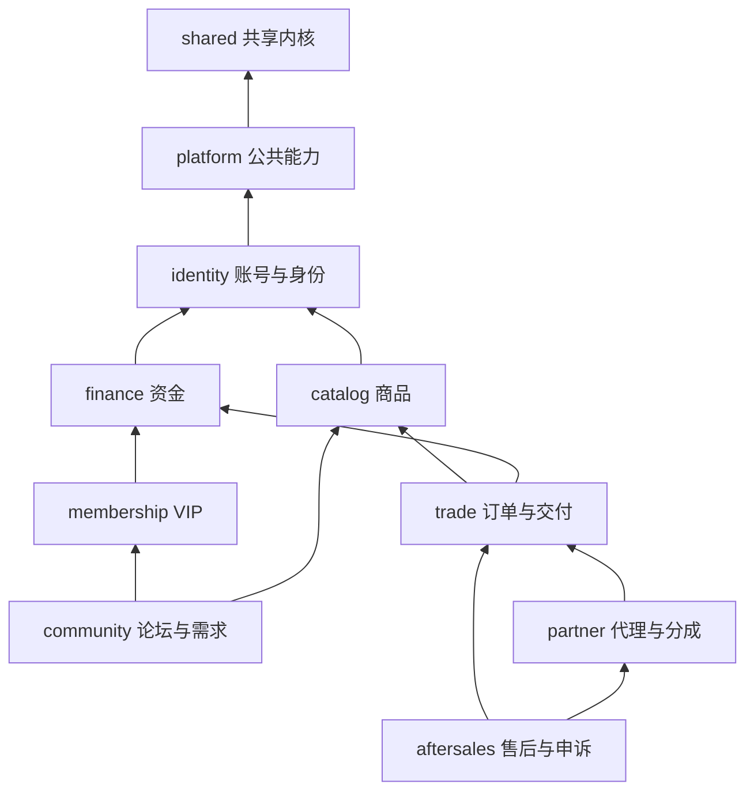

# 陪伴服务平台 技术架构与技术选型

*V1.3 · 2026-10-06 · 面向 AI 全程开发*

> V1.3 更新：首期只用 USDT 定价与结算，多币种只做准备（币种与汇率快照字段、汇率模块每天自动获取一次、失败时人工录入）；首期界面只开放中文与英语（i18next）。见第 4.7、4.14、5.7 节。
>
> V1.2 更新：补充多语言与多币种设计（第 4.14、5.7 节）；七个模块文档经项目负责人评审升为 V1.0，并新增页面与模块对照（`docs/acceptance/页面与模块对照.md`）。
>
> V1.1 更新：早期文档已直接覆盖为最新版本（建议稿 V1.2，现为 V1.3；完整产品规划 2026-10 修订）；新增七个模块文档、待定参数与决策记录、原型业务检查清单（索引见 `docs/README.md`）；中止申请的处理方式改为后台配置项，默认直接由平台处理，可改为先由公会处理。

---

## 0 文档说明

### 0.1 依据

| 来源 | 本文采用的内容 |
| --- | --- |
| 《陪伴服务平台 两端产品架构建议稿》V1.3（2026-10-06，由 V1.1 修订） | 一个用户端加一个运营后台；一级导航（首页、发现、广场、消息、我的）；多语言与多币种；统一账号，服务者认证后追加能力；主订单、周期账单、履约记录三层模型；中止与止付案件；四方对账；申请、复核、执行分岗；代理六项动作白名单 |
| 《陪伴服务平台 完整产品规划 · 调整前后对照》（2026-09-13；2026-10 修订版增加“2026-10 修订”标注） | 优先开发 H5 与 Web，首期不做原生 App；先功能后 UI；七个功能模块，每个模块一份 `.md`，由 AI 生成接口和业务逻辑；待确认参数（D01—D10）不得由研发或 AI 自行填写；收付只接 USD 数字货币；一对一真人语音 |
| 三端交互原型 V23 及《使用说明》（2026-10 各轮） | 全部页面与流程的交互参考；公会（MCN）、会员推广、USDT 余额钱包、周期结算服务、中止争议的最新规则；210 组业务检查（含多语言与多币种、性别、需求报价、互评、前后端对齐、体验、轮播与图文流、帖子图片与审核、卡片与显示规范、头像），另有 PC / H5 浏览器点击检查 |
| 团队现有项目 | piao666 后端使用 Java + Spring；zhibo、dataosha 前端使用 React / TypeScript + Vite |

`核心功能说明.docx` 属于其他项目（积分与合买），本文未采用。

### 0.2 早期文档的修订

以下早期写法已于 2026-10-06 修订，原文件已直接覆盖为最新版本：建议稿升级为 V1.3（另按原型更正一级导航、新增第 12 节多语言与多币种）；完整产品规划在受影响的章节加“2026-10 修订”说明（文中原有的“调整前／调整后”对照保留）。文件在 `docs/` 目录，下载目录和“其它”目录中的副本已同步。

| 早期写法（已作废） | 修订后规则 | 本架构处理 |
| --- | --- | --- |
| 建议稿第 8 节：不增加供用户自由充值、转账的钱包 | 新增余额钱包：充值、余额支付、分红与退款入账、提现，以 USDT 计价 | 按钱包设计，并区分“充值余额（仅消费）”与“可提现余额” |
| 建议稿第 7 节：单次、按天、按周，每期预付当期费用 | 一次付清整个服务期，会员选择每 1 / 3 / 7 天结算一次，到期自动结算 | 订单增加“服务期 + 结算周期”，结算由每日 00:00 任务执行 |
| 建议稿第 9 节：客服受理 → 售后复核裁决 → 财务执行 → 申诉 | 处理方式在后台设置：直接由平台处理（默认），或先由公会处理（服务者签约公会时，24 小时内未处理自动转平台）；平台处理记录处理人，24 小时内完成；每次结果后 24 小时异议期；平台复核为最终结果 | 处理方式是配置项，申请提交时保存快照；案件流程用状态机实现，两种路径共用平台处理、异议期与复核环节 |

### 0.3 版本选择规则

1. 有 LTS 的优先选 LTS。
2. 选择**发布满 12 个月**且仍在官方支持期内的稳定大版本。不用 Beta、RC 或刚发布的大版本。
3. 小版本及时跟进安全补丁。依赖升级设置至少 7 天的冷静期（Renovate、pnpm 的 `minimumReleaseAge`）。
4. 不满足第 2 条但必须采用的，单列原因（见第 3.3 节）。

版本信息核对日期为 2026-10-05，来源为各项目官方发布与支持周期页面（见附录 C）。

---

## 1 架构结论

- **形态：**前后端分离。后端是 Java 21 + Spring Boot 4.1 的**模块化单体**：一个代码库、一个镜像，按 api / realtime / worker 三种运行模式部署。模块边界与七份模块文档对应，需要时可以拆成独立服务。
- **数据：**PostgreSQL 17 是唯一事实来源，资金采用复式记账。Valkey 8.1（Redis 协议兼容）负责缓存、限流、在线状态、会话和实时消息扇出。对象存储保存图片、语音消息和证据材料。
- **前端：**React 19.2 + TypeScript 5.9 + Vite 7.3。
  - 用户端是一个应用，同时适配 H5 和 PC（两套布局外壳，延续原型 V23）。
  - 运营后台是一个应用（Ant Design 6），总控、代理、站长按权限显示。
- **接口：**REST，OpenAPI 由后端生成，前端用 Orval 生成类型和请求代码。实时通信用 WebSocket（STOMP）。
- **外部能力：**语音 RTC、数字货币收付、KYC、内容审核、邮件短信、对象存储都通过适配层接入，可以替换供应商。
- **多语言与多币种：**
  - 首期界面只开放中文与英语，前端使用 i18next。语言、分站语言配置、词条与译文、语言包发布与回滚都由后台管理，以后增加语言不需要改代码。
  - 首期只用 USDT 定价与结算。多币种只做准备：币种与汇率快照字段，以及汇率模块（每天自动获取一次，失败时人工录入）。
- **AI 开发：**模块文档 → 接口契约 → 代码 → 测试，以模块文档为唯一规则来源。CI 强制检查模块边界、类型、测试、迁移和契约。资金、权限、数据库迁移类改动必须人工审核。

---

## 2 总体架构



| 运行模式 | 职责 | 扩展方式 |
| --- | --- | --- |
| api | 用户端与后台的 REST 接口、外部回调（Webhook） | 无状态，按请求量水平扩容 |
| realtime | WebSocket 连接：聊天、通知、待办、语音房麦位状态 | 按连接数扩容；跨实例消息经 Valkey 发布订阅转发 |
| worker | 每日 00:00 周期结算与推广分红日结；24 小时时限扫描；渠道结果查询；对账；异步事件处理 | 可多副本；定时任务由数据库锁（ShedLock）保证只执行一次 |

---

## 3 技术选型

### 3.1 选型总表

| 层 | 选型 | 版本 | 选择理由 |
| --- | --- | --- | --- |
| 后端语言 | Java（Eclipse Temurin） | **21 LTS** | 2023-09 发布的 LTS；BigDecimal、强类型、编译期检查适合资金系统，AI 生成的错误能在编译阶段暴露。暂不用 25 LTS |
| 后端框架 | Spring Boot | **4.1.x** | 业界最成熟的 Java 应用框架；团队已有 Spring 经验。版本原因见 3.3 |
| 模块化 | Spring Modulith | 2.x（随 Boot 版本） | 在测试中校验模块边界；提供可靠的事件发布表（事务内落库，即 Outbox）；以后拆分服务时可把事件外发到消息中间件 |
| 安全 | Spring Security | 7.x（Boot 管理） | 会话、CSRF、方法级权限 |
| 持久化 | Spring Data JPA（Hibernate）+ Spring JdbcClient | Boot 管理 | JPA 处理聚合读写；JdbcClient 写报表与复杂查询 |
| 数据库迁移 | Flyway | Boot 管理 | 按模块管理 SQL 迁移脚本，可审查、可回溯 |
| 接口文档 | springdoc-openapi | 3.x | 由代码生成 OpenAPI 3，供前端生成客户端 |
| 定时任务 | Spring Scheduling + ShedLock | 稳定大版本 | 简单可靠，多实例只执行一次 |
| 限流 | Bucket4j（存储用 Valkey） | 稳定大版本 | 登录、发帖、提现等接口限流 |
| 构建 | Maven | 3.9.x | 声明式配置，AI 修改不易出错 |
| 数据库 | PostgreSQL | **17** | 支持至 2029-11-08。CHECK 约束与排他约束（防档期重叠）、JSONB 保存规则快照、部分索引、`SKIP LOCKED`、事务性 DDL、分区表 |
| 缓存等 | Valkey（Redis 协议兼容） | **8.1** | BSD 许可；维护至 2028-03-31，安全修复至 2030-03-31。也可用云厂商托管的 Redis 兼容服务 |
| 对象存储 | S3 兼容对象存储 + CDN | — | 用云厂商服务；浏览器通过预签名地址直传 |
| 前端运行与构建 | Node.js | **24 LTS** | 支持至 2028-04-30；只用于构建和本地开发 |
| 包管理 | pnpm（workspace） | 10.x | 单仓多包；支持发布冷静期 |
| 前端语言 | TypeScript | **5.9.x** | 暂不用 6.0、7.0（6.0 是过渡版，7.0 于 2026-07 发布，lint 等工具链仍在适配） |
| UI 框架 | React | **19.2.x** | 19 于 2024-12 发布并已稳定；暂不用 19.3（2026-09 发布）。项目是单页应用，不使用 Server Components |
| 构建工具 | Vite | **7.3.x** | Vite 8 于 2026-03 发布，暂不用；7.x 按官方策略仍有重要修复与安全补丁 |
| 路由 | React Router | 7.x（单页应用模式） | 2024-11 发布 |
| 服务端数据 | TanStack Query | 5.x | 缓存、重试、失效、分页 |
| 界面状态 | Zustand | 5.x | 轻量，规则少 |
| 表单校验 | React Hook Form 7 + zod 4 | — | zod 4 于 2025 年中发布稳定版，已超过 12 个月 |
| 用户端 UI | Tailwind CSS 4 + shadcn/ui（基于 Radix） | Tailwind 4.x | 组件源码放在仓库内，颜色、字号等使用设计令牌，后期整体重设计成本低；也是 AI 生成界面最熟悉的组合 |
| 后台 UI | Ant Design | **6.x** | 表格、表单、布局最成熟的后台组件库；版本原因见 3.3 |
| 图表 | Apache ECharts | 5.x | 经营报表 |
| 多语言 / 时间 | i18next + react-i18next + i18next-http-backend；浏览器 Intl API；Day.js（utc / timezone 插件） | 稳定大版本 | 首期语言包为 zh-CN、en-US；语言包由后台发布、按版本加载（可被 CDN 缓存）；数字、金额、日期按界面语言与展示时区格式化；右向左语言用 `dir` 与 CSS 逻辑属性 |
| 实时客户端 | @stomp/stompjs | 7.x | 与 Spring STOMP 配套 |
| 接口客户端生成 | Orval | 7.x | 从 OpenAPI 生成 TypeScript 类型和 TanStack Query hooks |
| 后端测试 | JUnit + AssertJ + Mockito + Testcontainers + ArchUnit | Boot 管理 | 集成测试使用真实的 PostgreSQL 与 Valkey 容器 |
| 前端测试 | Vitest + Testing Library + MSW + Playwright | 与 Vite 7 配套 | 单元、组件、端到端（PC 1280 / H5 375 / 320） |
| 代码规范 | 后端 Spotless + Checkstyle；前端 ESLint 9 + typescript-eslint 8 + Prettier 3 | — | 格式统一，减少 AI 生成差异 |
| 部署 | Docker 镜像 + 托管 Kubernetes + Helm | — | 镜像与配置一致；首期也可先用同一镜像加 Docker Compose |
| CI/CD | GitHub Actions + Renovate | — | 构建、测试、扫描、发布；依赖自动升级并设冷静期 |
| 可观测性 | OpenTelemetry + Prometheus + Grafana + Loki + Sentry | — | 指标、链路、日志、异常 |
| 语音 | 托管 RTC（声网 Agora 或腾讯云 TRTC，二选一）或自建 LiveKit | — | 通过 `RtcProvider` 适配层接入；按目标市场（D01）选定 |
| 数字货币收付 | 持牌数字货币支付服务商 | — | 通过 `PaymentGateway` / `PayoutGateway` 适配层接入；币种与网络按 D03 确定 |

### 3.2 未选方案及原因

| 方案 | 不选的原因 |
| --- | --- |
| Node.js / NestJS 全栈 | 可行，但资金账务需要的精确小数、长事务和 ORM 在 TypeScript 生态中变动更频繁；团队已有 Java Spring 后端经验 |
| Go 后端 | 并发性能好，但在大型业务系统的领域建模、ORM、后台类开发的成熟约定少于 Spring |
| 首期即拆微服务 | 分布式事务、运维和排错成本高；模块化单体保留按模块拆分的路径 |
| Next.js 服务端渲染 | 首期以登录后的业务功能为主，单页应用更简单稳定。分享与邀请链接的预览信息由后端输出轻量页面；SEO 需求明确后再评估 |
| MySQL | 可行；选 PostgreSQL 是因为约束、JSONB 快照、分区和任务队列能力更适合本项目 |
| 首期引入 RabbitMQ / Kafka | 首期用 PostgreSQL 事件发布表加 Valkey 即可满足；流量增长或拆分服务时再引入（Spring Modulith 支持事件外发） |
| ProComponents v3 | 核对时仍以预发布版本为主；后台直接用 Ant Design 6，并自建少量通用组件 |
| 自建链上节点和热钱包 | 私钥安全与合规风险高；首期接入持牌服务商 |
| 原生 App | 规划文档已确定首期不做；接口按令牌认证预留，以后可加 PWA 或原生 App |

### 3.3 版本例外说明

- **Spring Boot 4.1：**Spring 每个小版本只有约 13 个月的免费支持。3.5 的开源支持已在 2026-06-30 结束，4.0 将在 2026-12-31 结束。4.x 系列自 2025-11 正式发布，4.1 是当前受支持的版本（支持至 2027-07-31）。后续在同一大版本内每 6 个月升级一次小版本，风险较低。
  - **注意：**Spring Boot 4 默认使用 Jackson 3（包名 `tools.jackson`），而 springdoc 3.x 内部仍依赖 Jackson 2。业务代码统一使用 Jackson 3；AI 的训练资料以 Boot 3 为主，生成代码须以仓库内的样板为准。
- **Ant Design 6：**2025 年底发布，未满 12 个月。但 v5 已进入为期一年的维护期，只修严重问题；而 v6 与 v5 接口基本兼容，可以平滑迁移。新项目直接用 v6 更稳妥。

---

## 4 后端架构

### 4.1 模块划分

| 文档模块 | 代码模块 | 主要内容（含原型最新功能） | 核心数据 |
| --- | --- | --- | --- |
| 1 账号与身份 | `identity` | 注册登录、18+ 校验、头像（默认头像库与上传）、用户中心与服务者中心、服务者入驻与 KYC 结果、后台账号、岗位与数据范围 | user, provider, provider_application, kyc_record, admin_account, role, permission, data_scope |
| 1 账号与身份 | `membership` | 月度 VIP、权益快照、VIP 门槛判断 | vip_plan, vip_order, entitlement |
| 2 论坛与需求 | `community` | 板块话题、帖子回复、点赞收藏关注、结构化及匿名需求、立即找人匹配、组队房与活动、内容治理队列 | board, topic, post, reply, follow, demand, match_request, room, room_seat, moderation_task, post_like, post_image, image_review_setting |
| 3 商品与交付 | `catalog` | 服务模板（规则版本）、服务商品、档期、实物与定制内容商品定义 | service_template, rule_version, product, availability_slot, physical_product |
| 3 + 4 | `trade` | 主订单；服务期与结算周期；周期账单；履约单元；实物发货；周期到期自动结算；开始前取消；分账快照 | order, service_plan, bill, fulfillment, shipment, settlement, split_snapshot |
| 4 订单与资金 | `finance` | 余额钱包（充值余额 / 可提现）、数字货币充值与提现、支付、退款、出款批次、币种与汇率（首期只用 USDT；汇率每日自动获取与人工录入）、复式账务、四方对账 | wallet_account, recharge, withdrawal, payment, refund, payout, currency, fx_rate, fx_settings, fx_fetch_run, station_currency, ledger_journal, ledger_posting, reconciliation |
| 5 售后与申诉 | `aftersales` | 中止申请（服务不达标，可附图片）、按后台设置直接由平台处理（默认）或先由公会处理、平台处理与复核、24 小时时限与升级、异议期、执行；举报、风险案件、处罚与申诉 | dispute_case, case_statement, case_decision, case_objection, report, risk_case, penalty, appeal |
| 6 代理与分成 | `partner` | 分站与站长、代理归属与佣金、公会（MCN）签约与保证金、公会分成、会员推广（有效会员、等级、消费分红、日结） | station, station_rule, agent, agent_binding, guild, guild_contract, deposit, guild_share, promoter, referral, promotion_level, dividend_accrual |
| 7 公共能力 | `platform` | 会话与消息、通知与待办、帮助中心与客服工单、首页轮播图配置、语音 RTC、文件与证据、版本化配置与待定参数、多语言（语言、分站配置、词条与译文、通知模板、语言包发布）、内容审核适配、审计日志 | conversation, message, notification, support_ticket, home_banner, rtc_session, rtc_event, file_object, config_item, locale, site_language_config, i18n_entry, translation, language_release, audit_log |
| — | `shared` | 共享内核：Money、ID、时间（Clock）、错误码、分页、当前用户与数据范围 | — |

### 4.2 模块依赖方向



箭头表示“依赖于”。所有模块都可以依赖 `platform` 和 `shared`。约定如下：

- `trade` 不依赖 `partner`。分账比例（代理、分站、公会）通过 `trade` 定义的接口（SPI）获取，由 `partner` 实现，避免循环依赖。
- `partner` 监听 `trade` 的事件（如周期结算、退款）来计算公会分成和推广分红，并调用 `finance` 入账。
- `aftersales` 调用 `trade` 冻结或执行退款，调用 `partner` 查询服务者签约的公会以决定处理路径。
- `platform` 不依赖任何业务模块。待办通过 `platform` 定义的 `TodoSource` 接口由各模块实现，与原型的待办来源机制一致。
- Spring Modulith 在测试中校验依赖：出现循环或越界访问时构建失败。

### 4.3 模块内部结构

```
com.example.companion.trade            （包名待定）
├─ api/             对外公开：Controller、请求与响应 DTO（record）、对其他模块开放的接口、事件
├─ application/     用例服务：事务边界、权限与数据范围校验、幂等、审计
├─ domain/          实体、值对象、状态机、规则计算
├─ infrastructure/  JPA 仓储、外部适配器、定时任务
└─ package-info.java  声明模块及允许依赖的模块
```

- 其他模块只能使用 `api` 包里的内容。
- 不允许跨模块读写对方的表。跨模块写操作通过对方的公开接口或事件完成。

### 4.4 数据与持久化

- **库与表：**一个 PostgreSQL 实例，每个模块一个 schema；跨 schema 不建外键，只保存 ID。
- **主键：**由应用生成 UUIDv7（按时间有序）。面向用户的单号另设，例如 `MO-20260923-000123`。
- **时间：**数据库用 `timestamptz` 存 UTC。业务日期按分站或订单的时区计算。代码只用 `Instant` / `ZonedDateTime`，时间来源统一注入 `Clock`。
- **迁移：**Flyway，按模块分目录。已执行的迁移禁止修改，只能新增。
- **并发与幂等：**
  - 资金类聚合用乐观锁（version 字段）；余额行在变更时加行锁。
  - 业务唯一键加唯一约束，例如 `refund:{caseId}:{billId}`、`recharge:{id}`，保证重复请求只入账一次。
- **规则快照：**成交时把服务规则、分账比例、公会比例、推广比例、汇率写入 JSONB 快照字段，后续改规则不追溯已成交的订单。
- **大表：**消息、审计日志、账务分录按月分区；后期增加只读副本。
- **搜索：**首期用 PostgreSQL（pg_trgm 支持中文子串检索）加结构化筛选；数据量增大后引入 OpenSearch。

### 4.5 资金与账务

这是平台最核心、最需要严谨的部分。

1. **金额表示**
   - 数据库用 `NUMERIC(20,6)` 加币种代码。
   - Java 只用 `Money`（BigDecimal + 币种），禁止 `double` / `float`。
   - 舍入规则集中定义。账务精度、展示位数由币种配置决定，D03 确认后生效。
   - 首期定价与结算均为 USDT。数据模型保留定价币种与汇率快照字段，以后启用其他币种不需要改结构（见 4.14）。
2. **复式记账**
   - 每个资金动作生成一张凭证和多条借贷分录，借贷必须相等。
   - 余额 = 分录汇总；另有余额投影表用于加速查询，每天与分录核对。
   - 科目示例：会员钱包-充值余额、会员钱包-可提现、平台托管-服务订单待履约款、服务者应付、代理应付、分站应付、公会应付、推广分红应付、平台收入、提现在途、渠道手续费。
3. **订单资金流：**一次付清 → 平台托管（待履约）→ 结算周期到期，自动确认并按快照分账 → 服务者、代理、分站、公会进入可结算 → 提现或出款。
   - 中止申请期间，尚未结算的部分冻结。
   - 处理结果执行后，退款退回会员余额钱包，其余未结算部分结算给服务者。
4. **钱包**
   - 充值余额与可提现余额分两个科目。充值余额只能消费，后台可配置是否允许提现。
   - 提现申请会先冻结金额。
   - 退款按原扣款比例退回两个余额；推广分红进入可提现余额。
5. **外部请求**
   - 所有渠道请求带唯一请求号。结果未知时只能查询原请求，不得重新发起。
   - 回调必须验签并做幂等处理；“已到账”只记一次。
6. **日结**
   - 每天 00:00（按配置时区）依次执行：周期服务结算 → 推广分红入账 → 时限检查。
   - 同一日期只执行一次（唯一约束 + ShedLock）。可以补跑，但不会重复入账。
7. **对账：**订单、渠道、账务、出款四方对账每天运行。差异生成工单人工处理，不提供一键抹平。
8. **分权与审计：**申请人、审核人、执行人不能是同一人；每个关键动作记录操作人、依据和前后值。

### 4.6 状态机与规则版本

- 以下对象都使用显式状态机：订单、服务期、周期账单、履约单元、中止案件、退款、充值、提现、出款。实现方式是枚举 + 允许的状态迁移表 + 迁移前的条件检查，每次迁移写入历史表。不引入重量级的状态机框架。
- 中止案件的处理方式是后台配置项：直接由平台处理（默认），或先由公会处理（仅在服务者签约公会时出现公会环节）。申请提交时保存当时的处理方式，之后修改设置不影响已提交的申请。
- 环节顺序：（公会处理 → 异议期 →）平台处理 → 异议期 → 平台复核（最终结果）。每个环节的时限（默认 24 小时）也是配置项。
- 服务模板、分账、公会、推广、钱包参数都是带版本的配置，成交时固化为快照。

### 4.7 定时任务与时限

- **调度：**Spring `@Scheduled` + ShedLock（数据库锁），多实例部署时只执行一次。
- **时限：**24 小时处理时限、异议期、邀请有效期等，都把截止时间存入数据库，由每分钟运行的扫描任务处理到期记录，处理逻辑必须幂等。不使用内存定时器。
- **每日汇率获取：**按后台设置的时间（UTC）获取一次，同一业务日只自动获取一次。失败按退避重试 3 次，仍失败则保留上一版本并发出 `FxFetchFailed`（见 4.14）。
- **时间可测：**所有业务时间来自注入的 `Clock`。测试和预发环境提供“时间推进”的管理接口（类似原型的“模拟 00:00”按钮），用于验收周期结算和时限规则；生产环境禁用。

### 4.8 实时消息

- WebSocket + STOMP（Spring WebSocket），按用户、订单、语音房划分频道；鉴权复用登录会话。
- 多实例部署时，通过 Valkey 发布订阅把消息转发到持有该连接的实例。规模扩大后可以切换为 RabbitMQ 中继。
- 消息先写入 PostgreSQL（按月分区）再推送；离线消息和未读数从数据库计算。图片、语音消息存对象存储。

### 4.9 语音（一对一陪聊与语音房）

- 通过 `RtcProvider` 统一接口接入托管 RTC（声网 Agora 或腾讯云 TRTC，按目标市场覆盖、价格和合规选择），或自建 LiveKit。后端负责签发房间令牌、接收回调事件。
- 记录连接、断开、恢复事件，形成“连接区间”，作为计费与售后的参考证据。默认不录音，是否录音、保存多久由 D01 / D08 决定。
- **H5 风险：**iOS Safari 需要用户点击后才能开启音频，锁屏或切到后台会中断。必须真机测试，并提供自动重连。

### 4.10 数字货币收付

- 通过 `PaymentGateway` / `PayoutGateway` 接入持牌数字货币支付服务商。要求服务商提供：充值地址或支付单、回调签名、按商户单号查询、幂等出款、地址风险筛查、对账文件、沙箱环境。
- 首期不自建链上节点和热钱包。
- 代币、网络（如 TRC20 / ERC20）、汇率来源、手续费在 D03 确认之前保持“待定”，相关功能不可启用（见 4.13）。

### 4.11 文件与证据

- 浏览器通过预签名地址直传对象存储；服务端校验类型和大小，生成缩略图并去除图片位置信息。
- 证据存放在私有存储桶，只能通过短时效签名地址访问。保存期限与访问权限按 D01 / D08 配置。

### 4.12 身份、权限与安全

- **用户端登录：**服务端会话（Spring Session + Valkey），Cookie 设为 HttpOnly + Secure，并启用 CSRF 防护。以后增加原生 App 时，再加 OAuth2 令牌方式。
- **后台登录：**独立登录入口，TOTP 两步验证，敏感操作要求再次确认，可选 IP 白名单。
- **权限：**三层校验，统一放在用例服务（application 层）中完成：
  - 岗位权限（RBAC）。
  - 数据范围：总站、分站、代理工作项、公会。
  - 对象归属：本人在订单中是买方还是服务方。
- **分权：**申请人、审核人、执行人不能是同一人，由领域服务强制检查。
- **审计：**审计表只能追加，记录操作人、动作、对象、依据、前后值和请求号。
- **其他：**
  - 密码哈希使用 Argon2id 或 BCrypt。
  - 接口限流。
  - 敏感字段加密，密钥由云密钥服务管理。
  - 日志脱敏。
  - Webhook 验签。
  - 依赖与镜像漏洞扫描。

### 4.13 配置中心与待定参数

- 业务参数（费率、分成、门槛、时限、汇率、币种网络、中止申请处理方式等）都存放在带版本的配置表中，后台修改时必须填写依据。
- 每个参数有状态：**已确认**，或**待定**（标注 D01—D10 编号）。
  - 依赖待定参数的功能默认关闭；代码中不得写默认值。
  - 测试必须覆盖“参数待定时功能不可用”。
- 这条落实了规划文档“研发不能自行填写默认值”的要求。

### 4.14 多语言、时区与多币种

产品面向多个市场，架构上同时支持多语言与多币种；首期只开放中文与英语，只用 USDT。业务规则见模块文档 07（`PF-R012`—`PF-R021`）与 04（`TF-R021`—`TF-R029`）；原型对应“多语言与海外设置”九个页面与“币种与汇率”页面。

**多语言**

2026-10-13 补充：资料服务语言按 IP 地区自动确定（07 `PF-R031`），与界面语言及服务者能力分开。原型接入 Country API，仅使用国家/地区，8秒失败回退分站默认语言；生产应使用可信边缘 / 服务端 IP 地区。默认头像内部标识保留，用户可见列表不显示编号。修改记录统一维护于 `.work/prototype-updates.json`，构建同源生成原型说明与 `docs/修改说明.md` 并同步静态文档（07 `PF-R032`）。

- **首期语言：**中文（zh-CN）与英语（en-US）。前端用 i18next 加载这两个语言包；其他语言以草稿保留，以后补齐译文并按 D01 确认后启用，不需要改代码。
- **语言：**以 BCP 47 代码管理（如 zh-CN、en-US、ar-SA），记录文字方向（ltr / rtl）与启用状态。中文是原文与兜底语言，不能停用。
- **分站配置：**每个分站可继承平台，或独立配置开放语言、默认语言、备用语言、展示时区、12 / 24 小时制、日期格式、自动识别与用户切换。
- **词条与译文：**
  - 界面词条的键与中文原文随代码维护；构建时同步到 `platform` 模块的词条表。
  - 业务内容译文（商品、模板、会员说明、板块、站点介绍）存在数据库，按对象与字段关联。
  - 译文记录原文版本：原文变化后，旧译文标记为“原文已更新”。保存时校验变量与原文一致。
- **语言包：**
  - 发布前检查必要内容、变量与配置；发布生成不可变的版本快照，可以回滚。
  - 前端通过 `GET /api/v1/app/i18n/{locale}?release=` 加载，响应可被 CDN 长期缓存（版本号变化即失效）。
- **语言选择：**手动选择 → 账号偏好 → 浏览器偏好 → 分站默认语言 → 中文；缺少译文时按“当前语言 → 备用语言 → 默认语言 → 中文”回退。
- **后端：**只返回错误码与参数。通知模板按接收人的语言渲染，变量由业务模块提供。
- **不翻译的内容：**用户发布的内容、证据、处理理由。

**时区**

- 存储一律用 UTC。
- 业务日期（周期结算、日结、时限）按分站或订单保存的业务时区计算。
- 界面按用户的展示时区显示；修改展示时区不改变订单时区或结算周期。

**多币种（首期只用 USDT，其他币种只做准备）**

- **首期：**商品定价、订单、账单、钱包、充值、提现、分账、分红全部以 USDT 计价与结算，汇率为 1，不需要换算。
- **预留的数据结构：**
  - 每笔金额都带币种（ISO 4217 或 USDT）。
  - 订单与账单保留定价币种、USDT 金额、汇率与汇率版本字段；分站保留定价币种配置（首期都是 USDT）。
  - 以后启用其他币种不需要改表结构。
- **启用其他币种后的规则（按 D03 确认）：**
  - 支付时按当时汇率折算为 USDT 并在账单保存快照；之后的结算、分账、退款、分红都按快照计算，平台不承担成交后的汇率变动。
  - 资金记录保存双金额；账务按币种分账户、分别借贷平衡；报表按币种统计，合并时折算为 USDT 并注明汇率版本。
  - 每个币种定义小数位（USDT 账务 6 位；VND、JPY 0 位），折算后按目标币种舍入，舍入差额记入专门科目。

**汇率模块**

- **数据源适配：**`FxRateProvider` 接口；原型为模拟数据源，正式数据源按 D03 选择，可同时配置主备。
- **自动获取：**worker 每天按设置时间获取一次全部预留币种对 USDT 的汇率，写入只追加的 `fx_rate`（来源、数据源、业务日期、版本）。同一业务日只自动获取一次。
- **失败处理：**退避重试 3 次仍失败时，保留上一版本，记录 `fx_fetch_run` 失败原因，并通过 `TodoSource` 在今日工作台提醒总站。总站人工录入（须填写依据，同样生成版本）或手动立即获取。
- **配置：**是否开启、数据源、获取时间都是版本化配置，修改须填写依据。
- **有效性：**不是当天获取或录入的汇率标记为“待更新”。已启用的非 USDT 币种汇率失效时，暂停该币种的新下单（`TF-R029`）。首期汇率只作参考，不参与计价。

### 4.15 可观测性

- **采集：**OpenTelemetry Java Agent 采集指标、链路和日志。
  - 指标进 Prometheus。
  - 日志进 Loki，格式为 JSON 并带 traceId。
  - 看板用 Grafana。
  - Sentry 收集前后端异常。
- **业务告警：**日结失败、回调失败、对账差异、案件超时、出款结果长时间未知。

---

## 5 前端架构

### 5.1 应用与共享包

```
frontend/
├─ apps/web       用户端：H5 + PC 同一路由，两套布局外壳
├─ apps/admin     运营后台：总控 / 代理 / 站长，按权限生成菜单
└─ packages/
   ├─ api         Orval 生成的类型与 TanStack Query hooks（禁止手写请求）
   ├─ ui          用户端设计令牌与组件（Tailwind + shadcn/ui）
   ├─ i18n        语言包
   └─ config      tsconfig、ESLint、Prettier 共享配置
```

### 5.2 H5 与 PC 自适应

- 同一个应用、同一套业务组件，按屏幕宽度切换两套外壳：
  - `MobileShell`：底部五个一级导航，标题栏带返回。
  - `DesktopShell`：顶部导航加个人中心侧栏。
- 信息架构延续原型 V23。
- 移动端优先：触控尺寸、底部安全区、弹窗改为底部抽屉。首期不做原生 App，以后可加 PWA。

### 5.3 数据与状态

- 服务端数据用 TanStack Query；界面状态用 Zustand；表单用 React Hook Form + zod。
- WebSocket 收到消息后，直接更新 TanStack Query 的缓存，页面自动刷新。

### 5.4 UI 与后期重设计

- 规划文档要求先功能后 UI。功能阶段使用 shadcn/ui 基础组件；颜色、字号、圆角、间距全部使用设计令牌（CSS 变量）。
- 后期按规划所说的 “Google UI” 统一重设计时（工具待 D09 确定），只需替换令牌和组件层，不改业务代码。

### 5.5 运营后台

- 使用 Ant Design 6，并自建少量通用组件：查询表单 + 表格 + 详情抽屉 + 审核弹窗 + 导出。
- 菜单和按钮按权限码显示；后端仍做最终校验。

### 5.6 前端质量

- TypeScript 严格模式。ESLint 禁止直接使用 fetch / axios（必须走生成的客户端），禁止 `any`。
- Vitest 写单元测试；Playwright 写端到端测试，覆盖 PC 1280、H5 375 和 320 宽度，以及一个右向左语言（ar-SA）的截图检查。

### 5.7 多语言与金额展示

- **界面文字：**全部使用词条键（`t('order.cancel')`），禁止在组件里硬编码中文（ESLint 规则检查）。
- **语言包：**启动时按分站配置与用户偏好确定语言，从后端加载已发布的语言包，并缓存版本号。
- **首期语言包：**zh-CN、en-US；新增词条必须同时提供这两种语言。
- **右向左语言（预留）：**设置 `<html dir="rtl" lang="ar-SA">`。用户端使用 Tailwind 的逻辑属性与 `rtl:` 变体；后台使用 Ant Design `ConfigProvider` 的 `direction` 与对应 locale。
- **金额：**统一用 `<Money amount currency />` 组件，用 `Intl.NumberFormat` 按界面语言格式化，始终显示币种代码（首期为 USDT）；以后启用其他币种时，支付与退款处同时显示 USDT 金额与汇率。
- **日期：**用分站的日期格式与用户的展示时区（Day.js timezone）显示。
- **时区与地点名称：**按界面语言显示（中文：北京时间、东京时间、世界标准时间；英文：Beijing time、Tokyo time），可用 `Intl.DateTimeFormat` 的时区名称或语言包词条实现；接口与数据库仍保存 IANA 时区。用户端不展示分站名称（07 `PF-R029`）。
- **不翻译的内容：**用户内容的容器加 `data-user-content`，不参与界面翻译。
- **后台语言：**由管理员单独切换，不影响用户的语言偏好。

---

## 6 接口规范

| 项 | 约定 |
| --- | --- |
| 风格 | REST，统一前缀 `/api/v1`；用户端 `/api/v1/app/*`，后台 `/api/v1/admin/*`，外部回调 `/api/v1/webhooks/*`，WebSocket `/ws` |
| 幂等 | 资金类 POST 必须带 `Idempotency-Key`；服务端以业务唯一键兜底 |
| 错误 | RFC 9457（`application/problem+json`），带业务错误码，如 `TRADE_PLAN_ALREADY_STARTED`；前端按错误码翻译 |
| 金额 | 十进制字符串加币种，例如 `{"amount":"132.00","currency":"D"}`；涉及支付、退款、结算的响应同时返回 `usdt`、`rate` 与 `rateVersion` |
| 语言 | 已登录用账号的语言偏好；未登录时用 `Accept-Language` 推断首次语言；服务端错误只返回错误码与参数，由前端翻译 |
| 时间 | ISO 8601 UTC；业务时区单独字段返回 |
| 分页 | 游标分页；后台表格允许页码分页 |
| 契约 | 后端代码生成 OpenAPI → CI 导出 `openapi.json` 并提交 → Orval 生成前端客户端 → 检测破坏性变更（oasdiff） |

---

## 7 代码仓库结构

```
companion-platform/
├─ AGENTS.md                      AI 开发规则（附录 A）
├─ docs/
│  ├─ architecture/               本文档、架构决策记录（ADR）
│  ├─ modules/                    七个模块文档（01-账号与身份 … 07-公共能力），模板见附录 B
│  ├─ decisions/pending-params.md 待定参数 D01—D10 与决策记录 K1—K5
│  ├─ acceptance/                 F01—F16、S01—S32、原型 91 组业务检查、页面与模块对照
│  └─ prototype/                  原型 V23 与使用说明（交互参考）
├─ backend/                       Maven 单模块应用，按包划分业务模块
│  └─ src/main/java/com/example/companion/{shared,platform,identity,membership,catalog,community,trade,finance,partner,aftersales}
├─ frontend/                      pnpm workspace（第 5 节）
├─ deploy/
│  ├─ local/compose.yaml          PostgreSQL、Valkey、S3 模拟、邮件捕获
│  └─ helm/                       测试 / 预发 / 生产配置
└─ .github/workflows/             CI/CD
```

---

## 8 AI 全程开发方式

### 8.1 单一规则来源

- **四层顺序：**模块文档（产品规则）→ 契约（OpenAPI、错误码、事件、状态机表）→ 代码 → 测试。
- **规则编号：**每条规则有编号，例如 `TF-R010`。代码注释和测试名称都引用这个编号，便于追溯。
- **现有模块文档：**七个模块文档（V1.0 已评审，04、07 为 V1.1；共 125 条规则）在 `docs/modules/`（前缀 ID / CM / CT / TF / AS / PT / PF），可直接按第 8.2 节的流程开发；页面归属见 `docs/acceptance/页面与模块对照.md`。
- **变更顺序：**修改规则时先改文档，再改代码；不允许只改代码。

### 8.2 单个功能的标准流程

1. 读模块文档、验收场景和待定参数清单。
2. 列出数据变更和接口清单。
3. 编写 Flyway 迁移。
4. 实现领域模型与状态机，并写单元测试。
5. 实现用例服务（权限、数据范围、幂等、审计），用 Testcontainers 写集成测试。
6. 实现 Controller，更新 OpenAPI。
7. 生成前端客户端。
8. 实现页面（H5 和 PC）。
9. 编写端到端测试，对应 F / S 验收场景。
10. 更新模块文档和变更记录，提交 PR。

### 8.3 质量闸门（CI 必须全部通过）

| 检查 | 工具 |
| --- | --- |
| 编译与格式 | Maven、Spotless、Checkstyle；tsc、ESLint、Prettier |
| 模块边界与架构规则 | Spring Modulith 校验、ArchUnit（禁止 double 金额、禁止 `LocalDateTime.now()`、禁止跨模块访问仓储等） |
| 单元与集成测试 | JUnit + Testcontainers；Vitest |
| 状态迁移覆盖 | 每个状态机的每条迁移至少一个测试 |
| 数据库迁移 | Flyway 校验（禁止修改已执行的迁移） |
| 接口契约 | 导出 OpenAPI 与提交版本比对，检测破坏性变更 |
| 端到端 | Playwright（PC / H5 关键流程） |
| 多语言与金额 | 词条键缺失与变量一致性检查、禁止硬编码界面文字、右向左截图检查；金额必须带币种，禁止跨币种相加 |
| 安全 | 依赖漏洞扫描、密钥泄露扫描、镜像扫描 |

### 8.4 必须人工审核的改动

- 资金：金额计算、分账、退款、结算、提现、账务分录。
- 权限：岗位、数据范围、分权规则。
- 数据库迁移：尤其是修改或删除字段。
- 外部渠道：支付、出款、RTC、KYC 的接入与回调。
- 安全与 CI 配置、新增依赖、升级大版本。

### 8.5 原型与已有检查的复用

- 原型 V23 放入 `docs/prototype/`，作为界面与交互参考。
- 原型的 210 组业务检查（`verify-v22` 26、`verify-mcn` 46、`verify-service` 11、`verify-intl` 8、`verify-gender` 25、`verify-demands` 15、`verify-reviews` 22、`verify-alignment` 15、`verify-ux` 7、`verify-feed` 11、`verify-images` 8、`verify-cards` 8、`verify-avatars` 8）已整理为 `docs/acceptance/原型业务检查清单.md`，并按模块归类，作为后端第一批验收用例。
- 原型中的演示内容（演示地址、模拟回执、模拟汇率数据源、演示时钟）在正式系统中替换为配置项和真实适配器。

### 8.6 任务拆分建议

- 先做一个“样板模块”：如账号与身份的注册登录 + 审计 + 配置中心，把分层、测试、接口、页面的写法固定下来。后续模块照样板生成，AI 输出会更一致。
- 每个任务只做一个用例，PR 控制在可审查的规模。
- 资金链路先写测试，再写实现。

---

## 9 部署与运维

| 项 | 方案 |
| --- | --- |
| 环境 | 本地（Docker Compose）/ 测试 / 预发 / 生产 |
| 生产（首期） | 托管 Kubernetes（或同等容器服务）；api ≥ 2 副本、realtime ≥ 2、worker ≥ 1；托管 PostgreSQL（主备 + 时间点恢复）、托管 Valkey、对象存储 + CDN + WAF。部署区域按目标市场（D01）选择 |
| 发布 | GitHub Actions：构建测试 → 镜像扫描 → 数据库迁移任务 → 滚动发布；Helm 管理各环境配置 |
| 密钥 | 云厂商密钥服务；仓库中不存放任何密钥 |
| 备份 | 数据库时间点恢复，每月做一次恢复演练；对象存储开启版本管理 |
| 扩展路径 | 增加副本 → 读写分离 → 大表分区 → 按模块拆出独立服务（如 realtime、finance），事件改为经消息中间件外发 |

---

## 10 分阶段落地

| 阶段 | 内容 | 前置决策 |
| --- | --- | --- |
| P0 基础 | 仓库骨架、CI 闸门、登录与后台账号、权限、审计、配置中心、文件存储、样板模块 | 无 |
| P1 交易闭环 | 服务者入驻、商品与档期、浏览直购、周期结算订单、余额钱包与数字货币收付、一对一语音、中止争议与退款、四方对账 | K1—K5；D01—D04、D08 |
| P2 社区与增长 | 论坛与需求、VIP、公会（MCN）、会员推广、代理与分站、实物与定制内容 | D05—D07、D09 |
| P3 规模化 | 性能优化、搜索与推荐、更多市场和语言、PWA 或原生 App | 按运营数据决定 |

规划文档推荐的首单形态（“一对一真人语音陪聊 + 单次固定时长 + 浏览直购”）属于 P1 的最小子集。该形态待 K1 批准，批准后可以先单独上线。

---

## 11 技术风险与待确认

| 事项 | 影响 | 处理 |
| --- | --- | --- |
| D01 目标市场与运营主体 | 部署区域、数据驻留、内容与收付准入、RTC 选型 | 确认前不上真实交易 |
| D03 数字货币币种、网络与服务商 | 充值、提现、退款、汇率 | 适配层先行，确认前功能关闭 |
| RTC 供应商 | 语音质量、成本、海外覆盖 | 先用两家做真机对比测试再定 |
| iOS Safari 语音限制 | 锁屏、切后台、权限导致断线 | 真机测试、自动重连、按连接区间计费 |
| 内容审核与 KYC 供应商 | 发帖、图片、证件 | 适配层接入，按市场选择 |
| Spring Boot 4 生态适配 | Jackson 3 与 springdoc 混用；AI 生成 Boot 3 写法 | 仓库样板 + AGENTS.md 规则 + 编译检查 |
| AI 生成代码质量 | 规则误解、边界遗漏 | 规则编号追溯、CI 闸门、人工审核清单 |
| 依赖供应链 | 恶意或不稳定新版本 | 锁定版本、7 天冷静期、扫描 |
| 多币种 | 首期只用 USDT；以后启用的币种与正式汇率数据源未定（D03）；汇率波动、数据源故障 | 数据结构已预留；汇率快照锁定成交金额；每日自动获取失败时人工录入，过期汇率暂停该币种下单 |
| 多语言 | 译文质量、右向左布局、必要交易说明缺译 | 发布前完整性检查、母语人员确认措辞、右向左截图测试、可回滚 |

---

## 12 版本维护策略

- **Spring Boot：**每 6 个月一个小版本，在当前小版本免费支持结束前升级（4.1 → 4.2 / 4.3）。
- **Node.js：**24 LTS 支持至 2028-04。26 LTS 成熟后（约 2027 年）再评估升级。
- **PostgreSQL：**17 支持至 2029-11，2028 年规划大版本升级。
- **前端大版本（Vite、TypeScript、React、Ant Design）：**每年评估一次；新大版本发布满 12 个月再升级。
- **依赖更新：**Renovate 设置至少 7 天冷静期；安全补丁可以加急处理。

---

## 附录 A　AGENTS.md 草案

> 放在仓库根目录，所有 AI 编码工具开工前必须阅读。

```markdown
# AGENTS.md — 陪伴服务平台

## 开工前必读
- docs/architecture/技术架构与技术选型.md
- 当前任务对应的 docs/modules/<模块>/ 文档与验收场景
- docs/decisions/pending-params.md（待定参数，禁止代填）

## 技术栈（不得擅自升级大版本或新增依赖）
- 后端：Java 21、Spring Boot 4.1、Spring Modulith 2、JPA + JdbcClient、Flyway、PostgreSQL 17、Valkey 8.1
- 前端：Node 24、pnpm 10、TypeScript 5.9、React 19.2、Vite 7.3、React Router 7、TanStack Query 5、
  Zustand 5、React Hook Form 7 + zod 4、Tailwind 4 + shadcn/ui（用户端）、Ant Design 6（后台）

## 常用命令
- 本地依赖：docker compose -f deploy/local/compose.yaml up -d
- 后端：cd backend && ./mvnw verify   （含测试、模块边界与架构检查）
- 前端：cd frontend && pnpm install --frozen-lockfile && pnpm -r typecheck && pnpm -r lint && pnpm -r test
- 生成接口客户端：pnpm --filter @app/api generate
- 端到端：pnpm --filter web e2e

## 硬性规则
1. 业务参数（金额、比例、门槛、时限、币种、网络）只能读配置中心；待定参数不得写默认值，相关功能保持关闭。
2. 金额只用 Money / BigDecimal 和 NUMERIC；禁止 double、float。
3. 时间只用 Instant / ZonedDateTime，并通过注入的 Clock 获取；禁止 LocalDateTime.now()、new Date()。
4. 模块之间只能调用对方 api 包里的接口或监听其事件；禁止访问其他模块的仓储或表。
5. 资金写操作必须：幂等键 + 唯一约束 + 状态机校验 + 审计记录；外部请求结果未知时只查询原请求，禁止重发。
6. 已执行的 Flyway 迁移禁止修改，只能新增。
7. 前端只能使用生成的 API 客户端；禁止手写 fetch / axios。
8. Spring Boot 4 使用 Jackson 3（tools.jackson 包）；业务代码不得引入 Jackson 2 API。
9. 不使用 Lombok；DTO 与值对象使用 record。
10. 权限在 application 层统一校验：岗位 + 数据范围 + 对象归属；申请、审核、执行不得为同一人。
11. 每次改动必须附测试；每条状态迁移必须有测试。测试名引用规则编号（如 TF-R010）。
12. 日志不得输出密码、令牌、证件号、完整地址或完整收款地址。
13. 新增依赖、升级大版本、修改 CI 或安全配置，必须先征得人工批准。
14. 界面文字只能使用词条键，禁止硬编码中文或其他语言；新增词条须同时提供中文原文。用户发布的内容不参与翻译。
15. 金额必须带币种；不同币种禁止直接相加；涉及支付、退款、结算时同时处理定价币种金额与 USDT 金额（首期两者相同），汇率取成交时的快照，不取当前汇率。
16. 时间存 UTC；业务日期按分站或订单的业务时区计算；展示时区只影响显示。

## 完成标准
- 后端 ./mvnw verify 与前端全部检查通过。
- OpenAPI 已更新，前端客户端已重新生成。
- 模块文档与变更记录已同步。
- 涉及资金、权限、迁移、外部渠道的改动，在 PR 描述中标注“需人工审核”。
```

---

## 附录 B　模块文档模板

> 七个模块各一份。AI 根据这份文档生成迁移、接口、业务逻辑、页面和测试。

```markdown
# <编号> <模块名> — <功能名>

- 规则编号前缀：TF-（示例，各模块前缀见 docs/modules/README.md）
- 状态：草稿 / 已评审（评审人、日期）
- 对应原型页面：…；对应交互：I01—I10 中的 …；对应验收：F.. / S..
- 依赖的待定参数：D03 …（未确认前功能关闭）

## 1 目标与范围（首期包含 / 后置）
## 2 角色与权限（角色 × 动作 × 数据范围 × 对象归属）
## 3 页面与入口（H5 / PC / 后台）
## 4 数据与字段（字段、类型、必填、校验、来源、是否进入快照）
## 5 主流程（编号步骤）
## 6 状态机（状态、迁移、触发方、前置条件、副作用、通知）
## 7 业务规则（TF-R001 …，含计算公式与舍入方式）
## 8 异常与边界（超时、重复提交、结果未知、并发）
## 9 资金与证据影响（科目、凭证、快照、可追溯材料）
## 10 接口（方法、路径、请求与响应、错误码、是否需要幂等键）
## 11 事件（发布 / 订阅）
## 12 通知、待办与审计
## 13 验收场景（Given / When / Then，引用 F / S 编号与原型检查）
## 14 待定参数（D 编号；不得由研发或 AI 代填）
```

---

## 附录 C　版本核对（2026-10-05）

| 组件 | 选定版本 | 核对信息 |
| --- | --- | --- |
| Java | 21 LTS | 2023-09 发布的 LTS；25 LTS 于 2025-09 发布，暂缓 |
| Spring Boot | 4.1.x | 2026-06-10 发布，开源支持至 2027-07-31；4.0 支持至 2026-12-31；3.5 已于 2026-06-30 结束开源支持 |
| Spring Modulith | 2.x | 2.0 于 2025-11-21 正式发布，基线为 Spring Boot 4 |
| springdoc-openapi | 3.x | 支持 Spring Boot 4；内部仍依赖 Jackson 2 |
| PostgreSQL | 17 | 2024-09-26 发布，支持至 2029-11-08；18 于 2025-09 发布 |
| Valkey | 8.1 | 2025-03-31 发布，维护至 2028-03-31，安全修复至 2030-03-31 |
| Node.js | 24 LTS | 2026-10-20 进入维护期，2028-04-30 结束支持；26 于 2026-10-28 进入 LTS |
| TypeScript | 5.9.x | 6.0 为过渡版本，7.0 于 2026-07-08 发布，暂缓 |
| React | 19.2.x | 19 于 2024-12 发布；19.2 于 2025-10 发布并持续出补丁；19.3 于 2026-09-09 发布，暂缓 |
| Vite | 7.3.x | 8.0 于 2026-03-12 发布；按官方策略，上一大版本仍获重要修复与安全补丁 |
| Ant Design | 6.x | 2025 年底发布；v5 进入一年维护期；ProComponents v3 要求 antd 6，核对时仍以预发布为主 |
| Tailwind CSS | 4.x | 2025-01 发布；shadcn/ui 新项目默认 Tailwind 4 + React 19 |
